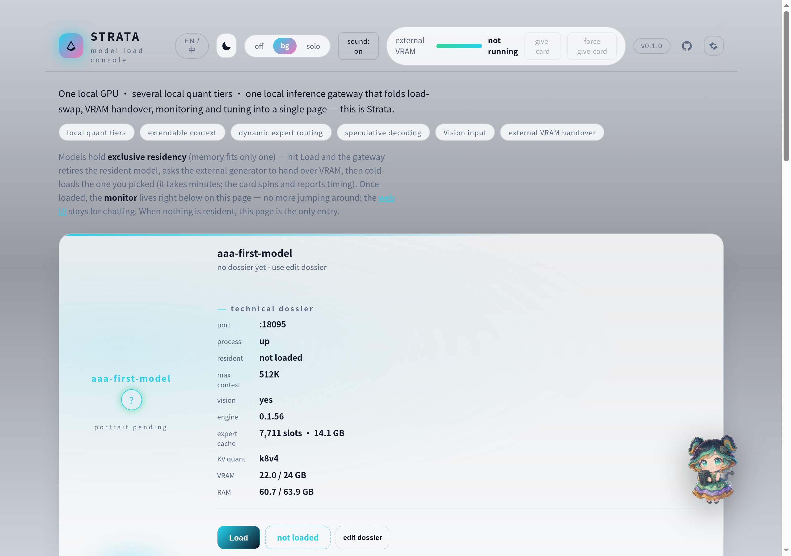
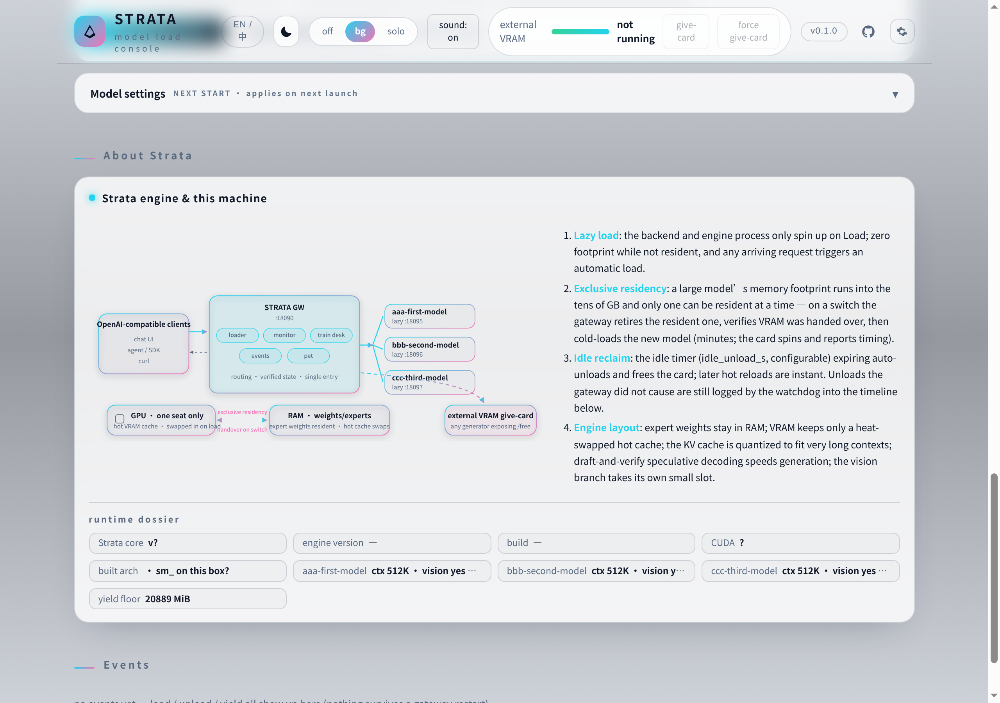
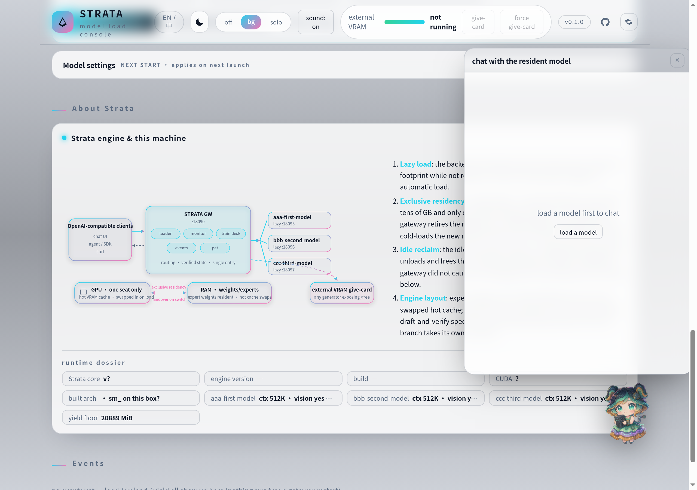

# STRATA — the Strata gateway

**One local GPU · several local models · one gateway that folds load-swap, VRAM
handover, monitoring and tuning into a single page.**



Strata-gw is the gateway + web console layer of a personal "model loading
desk": it manages N model backends on **one GPU**, exactly one of which may be
resident at a time. Load / unload / switch are explicit, verified actions with
an events timeline — no hidden autoswap. On top of the routing it ships a
live monitor (tokens/s, VRAM, RAM, expert cache, GPU thermals), a per-model
tuning desk, an events log, an optional desk-pet with chat window, and
full-page EN/中文 bilingual UI.

It requires **your own Strata engine install** (the engine providing
`serve/server.py`). The gateway itself is stdlib-only Python — no pip installs.

## How it works



- Every backend is an OpenAI-compatible server; the gateway exposes one
  aggregated OpenAI-compatible endpoint plus a `router/*` control API.
- **Lazy spawn:** a backend's engine process starts only when needed.
- **Exclusive residency:** switching = unload current → verify VRAM handover →
  load next. State comes from the engine, never from optimistic guesses.
- **Idle reclaim:** an idle resident model can auto-unload (`idle_unload_s`).
- **External VRAM handover (optional):** if another GPU consumer exposes
  `/free` and `/system_stats` (e.g. an image generator), the gateway can ask
  it to yield VRAM before loading — configure `gpu_free.urls` in gateway.json.
- Endpoints the gateway proxies but your engine may not implement
  (`/settings`, `/config`, `/metrics`, …) surface in the panel as
  *unavailable* — they never break the page.

## Three-minute setup

```bash
git clone <this repo> strata-gw
cd strata-gw
cp config-examples/gateway.example.json gateway.json        # optional knobs
cp config-examples/strata-backend.example.json strata-mymodel.json
#   edit strata-mymodel.json: model_name / model_dir (port 0 = auto-assign)
```

Point the gateway at your engine root (`serve/server.py` + `.venv` inside):
either set `STRATA_HOME`, or put `"strata_home"` into `gateway.json`, or leave
the gateway checked out *inside* the engine root. To pick a specific python,
set `STRATA_PYTHON`.

Start it (Windows: double-click `launcher/strata-gateway.cmd` after editing
its `GW_HOME` line; Linux/macOS):

```bash
bash launcher/strata-gateway.sh        # or: python3 strata-router.py
```

Open `http://127.0.0.1:18080/gateway`. Default gateway port `18080`
(override with `STRATA_ROUTER_PORT`); backend ports are auto-assigned from
`18101`. Verify from a terminal:

```bash
curl -s http://127.0.0.1:18080/router/version
```

Point any OpenAI-compatible client at `http://127.0.0.1:18080` and load a
model from the page (or via `POST router/load {"model":"mymodel"}`).

## Cards, dossiers & art

`cards/cards.json` holds per-model presentation: nick, portrait, persona
notes, dossier text. The page's **edit dossier** button creates a card for an
installed model with no card yet; factory cards for models you don't run show
as *not installed* and can be one-click deleted. Portraits are uploaded
through the page (stored under `gw-assets/uploads/`, git-ignored).

## gateway.json keys

| key | meaning |
|---|---|
| `strata_home` | engine root (overrides repo root; env `STRATA_HOME` wins) |
| `github_url` | target of the header GitHub button |
| `gpu_free.urls` | list of `/free`-capable yield endpoints |
| `gpu_free.target_mib` | VRAM floor to demand; `0` = auto water-line |
| `gpu_free.gentle_wait_s` / `wait_s` / `timeout_s` | yield pacing |

## The pet

A draggable desk-pet (`⚙` → pet) sits on the page; tap it for a chat window
bound to the resident model. Its portrait is served as a virtual model
`_pet` through the same gateway. Drag = move (persisted), menu = size /
off. It respects `prefers-reduced-motion`.



## Tests

```bash
python3 tests/test_gateway_switch.py strata-router.py   # the big baseline suite
for f in tests/test_*.py; do python3 "$f"; done         # every suite, incl. hygiene lint
```

All green = safe to poke at. The baseline suite boots stub backends on ports
1809x–1810x, so don't run it beside a live demo.

## Built by

strata-gw 的代码、测试、文档与页面设计，全部由一台 RTX 3090 + 64GB DDR4
家用机上、经 Strata 本地推理网关跑起的 **qwen3.8-flash-next-iq3_s** 写成——
就是这张加载台所服务的模型；示例立绘与背景视频同样出自这台机器。每段 git
历史都带 `Written-by: qwen3.8-flash-next-iq3_s via strata-gw
(RTX 3090, 64GB DDR4)` trailer，欢迎点查；后续维护仍由它继续。

All of strata-gw's code, tests, docs and page design were written by
**qwen3.8-flash-next-iq3_s**, running on a home machine (RTX 3090, 64GB DDR4)
behind the very Strata gateway this console drives — the same model this desk
serves for you. The example portraits and the background video were generated
on the same machine. Every commit carries a
`Written-by: qwen3.8-flash-next-iq3_s via strata-gw (RTX 3090, 64GB DDR4)`
trailer; future maintenance continues the same way.

## License

MIT — see [LICENSE](LICENSE).
