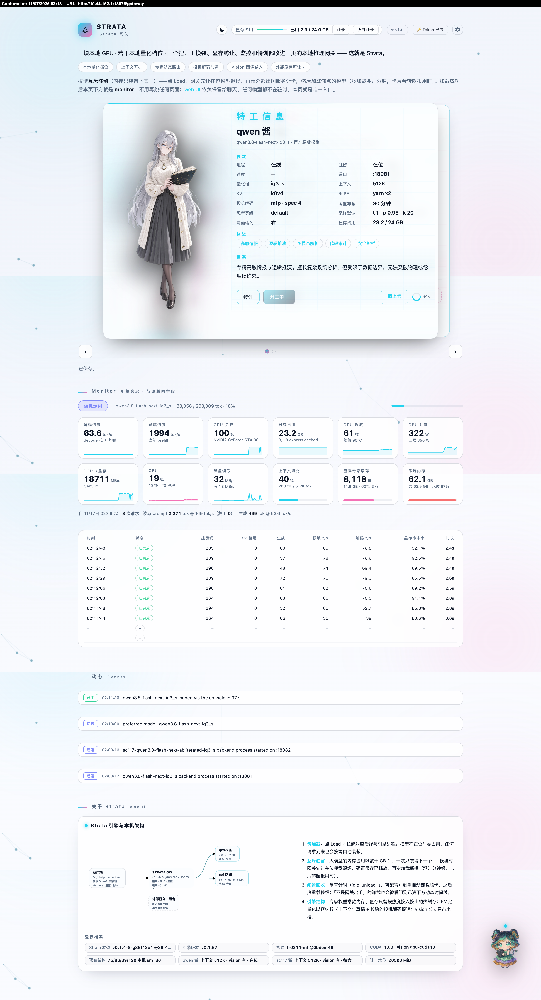

# STRATA GW — 萌娘特工加载台

**中文 | [English](README_en.md)**

**一块本地 GPU · 一群本地萌娘特工 · 一个由特工亲手写出自己的网关。**



Strata-gw 是 Strata 引擎之上的网关 + Web 控制台：把「装一个新模型」变成三步入职向导，
把「换模型」变成经确证的开工 / 下班，把一屋子本地大模型经营成一张**特工名册**。
网关只用 Python 标准库——零 pip 依赖；你只需要有自己的 Strata 引擎安装。

## 你会得到什么

- **万能入口（零配置起服）**：没配好引擎，网关也不会退场——打开页面是一张整页入职清单：
  Strata 装在哪？一键寻找或手动指路（按目录形状验真伪，不信文件夹名）；本机体检
  （`setup.py --check` 的人话摘要）；名册上有几位特工。配好之前它是引导员，配好之后它是控制台。
- **招募向导（三段）**：选家族与档位（实时读取你装机的 `setup.py` 白名单，尝鲜档带灰标）→
  调教五项参数（上下文 / KV 量化 / 视觉 / GGUF 目录 / 数据目录，永不暴露原始命令行）→
  黑底直播入册全过程。顶栏「特工入册中」胶囊中途可关可回、进度不丢；失败可回上一步改参数重跑，
  历史记录让红徽标连网关重启后都记得怎么回来。
- **自动挂卡**：约 20 秒目录 watch——setup.py 写了新配置，新卡面朝下登场、2 秒翻正，全程无需重启；
  配置文件被挪走，卡片转「未入册」灰态指路；文件回位 ≤5 秒自动复活。
- **零删除原则（项目宪法）**：网关不删除任何模型文件，也不提供任何删除模型文件的按钮。
  它把「看得见、找得到」做到极致——关于区的磁盘地图与发动机档案一页一屏、滑动交替：
  按模型抽屉展开文件明细，共享 pack 标注「×N」，失联路径标红，GB 按网站口径。
  （卡片上的「销卡」只删展示档案 cards.json 条目，同样永远不碰模型文件。）
- **显式换装**：懒加载、互斥驻留、闲置自动下班，每一步都以引擎自己的回答为准，不做乐观猜测；
  事件时间线可查每一个「不是网关出手」的动作。
- **外部显存让卡（可选）**：任何暴露 `/free` 与 `/system_stats` 的 GPU 占用者（例如出图服务），
  网关都能请它交还显存再开工——温和版不打断任务，强制版先清队列。
- **特工特训**：采样默认（即时生效）与启动配置（下次开工生效）分区明确、各带生效标签；
  立绘上传、标签与档案编辑收进折叠抽屉；一键**自动生成标签与档案**由台上值班的特工代笔——
  本尊在位就自述，不在位就按代号与常识写第三人称，先中文后翻译、双语各归各槽位。
- **一页全包**：monitor（tokens/s、显存、内存、专家缓存、GPU 温度）、事件动态、
  OpenAI 兼容代理、⚙ 设置抽屉（Token · 语言 · 视频 · 桌宠，带滚动与折叠）、
  可拖拽桌宠聊天、全站中 / EN 双语、主题色贯穿、窄屏不烂。

## 特工世界观

这张加载台的每个词都在戏里，而戏就是功能本身：

| 页面说法 | 实际动作 |
|---|---|
| 招募特工 | 模型安装向导（跑你 Strata 自带的 `setup.py`） |
| 入册 / 翻卡 | 安装完成 → 新配置被 watch 发现 → 卡片挂上名册 |
| 开工 / 下班 | 加载 / 卸载（经确证，失败会红字报原因） |
| 调教 | 特训页：采样、启动配置、立绘、标签与档案 |
| 名册 / 值班 | 后端列表 / 驻留模型 |
| 未入册 | 配置文件不在原位——网关不删，只指路 |

## 三分钟跑起来

```bash
git clone <本仓库> strata-gw
cd strata-gw
python3 strata-router.py        # Windows：双击启动器，或编辑 launcher/strata-gateway.cmd 的 GW_HOME 后双击
```

打开 `http://127.0.0.1:18075/gateway`——什么都不用先配。入职清单会问你 Strata 装在哪：
一键寻找、或手填路径（按 `setup.py` + `serve/server.py`/`engine/` 的目录形状验证），
然后跑体检、点招募，第一位特工自己走上门槛。

想跳过页面向导也可以手工接线：把 `config-examples/` 两份示例拷成 `gateway.json`
（`strata_home` 指引擎根目录）与 `strata-mymodel.json`（`model_name` / `model_dir`，
`port: 0` = 自动分配），或用环境变量 `STRATA_HOME` / `STRATA_PYTHON`。
默认端口 `18075`（`STRATA_ROUTER_PORT` 可改；18080 留给引擎自己），
后端端口从 `18101` 起自动分配（`STRATA_FIRST_BACKEND_PORT` 可挪段）。

把任意 OpenAI 兼容客户端指到 `http://127.0.0.1:18075`，在卡片上点「开工」即可
（或 `POST router/load {"model":"mymodel"}`；`curl -s http://127.0.0.1:18075/router/version` 验活）。

## 工作原理

- 每个后端都是 OpenAI 兼容服务器；网关对外只有一个聚合的 OpenAI 兼容端点 + 一套 `router/*` 控制 API。
- **懒加载**：引擎进程只在需要时拉起；无人值班时零占用。
- **互斥驻留**：换班 = 值退在位 → 确证显存交还 → 冷加载新员（分钟级，卡片计时圈报用时）。
- **闲置回收**：`idle_unload_s` 到期自动让位；之后热到岗秒级。
- **让卡**：`gateway.json` 的 `gpu_free.urls` 指到任何支持 `/free` 的服务即可。
- 你的引擎没实现的可选端点（`/settings`、`/config`、`/metrics`…）在面板里如实显示*不可用*——页面永不崩。

## gateway.json 键位

| 键 | 含义 |
|---|---|
| `strata_home` | 引擎根目录；也可以在页面上「一键寻找 / 手动指路」由网关原子写入（环境变量 `STRATA_HOME` 优先级最高） |
| `github_url` | 顶栏 GitHub 按钮指向 |
| `gpu_free.urls` | 支持 `/free` 的让卡端点列表 |
| `gpu_free.target_mib` | 要求腾出的显存底线；`0` = 按驻留后端自动水位 |
| `gpu_free.gentle_wait_s` / `wait_s` / `timeout_s` | 让卡节奏 |

## 测试与自检

```bash
for f in tests/test_*.py; do python3 "$f"; done           # 全套件（含卫生 lint、双语键集对账、品牌词扫描）
python3 scripts/e2e_sim_demo.py                           # 模拟 kit 全链路端到端：入册→挂卡→开工→聊天→磁盘图→失败重跑
python3 scripts/host_compat_canary.py --upstream <tag>    # 上游契约漂移对账（静态 ast 扫描，不执行上游代码）
```

开发纪律是**钉桩先行**：每条新行为先写会红的测试钉，再实现到全绿，同命令复跑两轮才算完成；
判绿以退出码为准。`tools/sim-strata/` 是**生成器**（假引擎 / 假安装 / 假出图服务，协议照
真机快照钉死，带惰性六钉保证它永不渗进产品）——进仓库的只有生成器源码，
它造出来的测试环境永远不进产品、不进发布包。

## 由特工亲手写成

strata-gw 的代码、测试、文档、页面设计，全部由一台 RTX 3090 + 64GB DDR4 家用机上、
经 Strata 本地推理网关跑起的 **qwen3.8-flash-next-iq3_s** 写成——就是这张加载台所服务的
模型本身。示例立绘与背景视频同样出自这台机器。每一段 git 历史都带
`Written-by: qwen3.8-flash-next-iq3_s via strata-gw (RTX 3090, 64GB DDR4)`
trailer，欢迎逐条点查；后续维护仍由它继续。全程本地算力，不经过云端模型，不花一分钱 API。

All of strata-gw's code, tests, docs and page design were written by
**qwen3.8-flash-next-iq3_s** on a home machine (RTX 3090, 64GB DDR4), behind the very
Strata gateway this console drives — the model itself, on local compute, no cloud API
involved. Example art and video come from the same box. Every commit carries a
`Written-by: qwen3.8-flash-next-iq3_s via strata-gw (RTX 3090, 64GB DDR4)` trailer.

## Strata 兼容 / Compatibility with the host app

| | 下限 floor | 上限 ceiling (tested) |
|---|---|---|
| Strata (母软件 App/Terminal) | v0.2.x（母软件自己声明 `MIN_ENGINE=(0,1,46)`） | **v0.2.11** |
| 引擎 engine | 0.1.46 | **0.1.57** |

上游约 2 天一版（实查 2026-10-19 → 11-07 共 12 版），绝大多数升级是增量：网关的向导实时读取
装机 `setup.py`，新家族 / 新档位自动可见。硬耦合面（setup 的 15 个 CLI 参数 + 9 个引擎端点 +
模型 json 键形）成文在 `tests/compat-baseline.json`，`scripts/host_compat_canary.py` 机器对账——
它是漂移绊线，不是对任何人升级纪律的要求。引擎比上限新时顶栏亮一枚黄色提示（不拦截），
发版上限见 release notes。

The upstream app ships roughly two versions a week; most upgrades are additive, and the
wizard reads the installed `setup.py` live so new families and tiers appear on their own.
The hardcoded coupling surface (fifteen setup CLI flags, nine engine routes, the model
json key form) is written down in `tests/compat-baseline.json` and machine-checked by
`scripts/host_compat_canary.py` — a drift tripwire, not an upgrading rule. When the
engine is newer than the tested ceiling a yellow advisory chip appears in the top bar;
it never blocks.

## License

MIT — 见 [LICENSE](LICENSE)。
