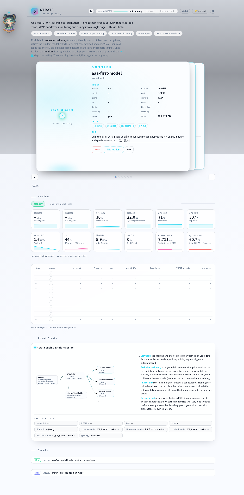

# STRATA GW — the moe-operative loading desk

**[中文](README.md) | English**

**One local GPU · a roster of local moe operatives · a gateway written by the
very models it serves.**



Strata-gw is the gateway + web console on top of the Strata engine: it turns
"install a new model" into a three-step enlistment wizard, turns "swap models"
into verified clock-in / clock-out moves, and runs a houseful of local LLMs as
a **roster of operatives**. The gateway is stdlib-only Python — zero pip
dependencies; all it asks for is your own Strata engine install.

## What you get

- **A universal entry (zero-config boot).** The gateway refuses to quit when
  nothing is configured — it opens as a full-page onboarding checklist instead:
  where is Strata installed? let the page **search the usual places** or
  **point at the folder yourself** (trust is earned by folder *shape* —
  `setup.py` plus `serve/server.py`/`engine/` — never by name); the PC check
  (`setup.py --check` in plain words); how many operatives are on the roster.
  A guide until configured, a console after.
- **The recruit wizard (three steps).** Pick family and tier (read live from
  your install's own `setup.py` whitelist; experimental families carry a
  badge) → tune five parameters (context, KV quant, vision, GGUF dir, data dir
  — raw command lines are never exposed) → watch the enlistment narrate itself
  over a black terminal live-log. The header chip stays re-enterable mid-run,
  progress never lost; failures step back with every parameter preserved, and
  the retry badge survives gateway restarts.
- **Cards mount themselves.** A ~20 s directory watch: when `setup.py` writes a
  new config, the card lands face-down and flips upright in 2 s — no restart.
  If a config file moves away the card greys to *unregistered* and points the
  way; put it back and the card revives within ~5 s.
- **The zero-deletion constitution.** The gateway never deletes a model file
  and offers no button that could. It perfects *see it, find it* instead: the
  About section slides between two same-width pages — engine dossier and a
  read-only disk map with a drawer per model, shared-pack cross-tags, dangling
  paths flagged, GB in the website sense. (The card *burn* only removes its
  decorative entry in `cards.json`; model files stay everyone's business.)
- **Explicit swaps.** Lazy spawn, exclusive residency, idle auto clock-out —
  every verdict comes from the engine itself, never an optimistic guess; the
  events timeline remembers even the moves the gateway did not cause.
- **External VRAM handover (optional).** Any GPU holder exposing `/free` and
  `/system_stats` (an image service, say) can be asked to hand the card back
  before a clock-in — gentle mode never interrupts a running job; force mode
  drains the queue first.
- **Drills (training).** Sampling defaults (live, instant) and launch config
  (next clock-in) in clearly labelled drawers, portrait upload, tag/bio editing
  — and one-click **auto-written tags & bio**: the resident operative pens a
  Chinese self-report, then translates it, both landing in their language
  slots; an off-post card gets a third-person dossier ghost-written by whoever
  is on duty, from codename and common sense alone.
- **One page, everything**: live monitor (tokens/s, VRAM, RAM, expert cache,
  thermals), events feed, OpenAI-compatible proxy, a scrolling drawer-organised
  ⚙ popover (token · language · video · pet), a draggable desk-pet chat, full
  EN/中文 bilingual UI, theme colour all the way through, sane at narrow widths.

## The operative worldview

Every word on this desk stays in character — and the character *is* the feature:

| on screen | in fact |
|---|---|
| recruit an operative | model install wizard (runs your install's own `setup.py`) |
| enlistment / the card flip | install done → watch discovers the config → card joins the roster |
| clock in / clock out | load / unload (verified; failures report in red) |
| drill | training page: sampling, launch config, art, tags & dossier |
| roster / on post | backend list / resident model |
| unregistered | the config file is out of place — the gateway deletes nothing, it points the way |

## Three-minute start

```bash
git clone <this repo> strata-gw
cd strata-gw
python3 strata-router.py        # Windows: double-click the launcher, or edit GW_HOME in launcher/strata-gateway.cmd
```

Open `http://127.0.0.1:18075/gateway` — nothing to preconfigure. The
onboarding page asks where Strata lives: let it search the usual places or
type the path (validated by shape, not name), run the PC check, hit recruit,
and the first operative walks in through the door.

Prefer the manual wiring? Copy the two files from `config-examples/` to
`gateway.json` (point `strata_home` at the engine root) and
`strata-mymodel.json` (`model_name` / `model_dir`, `port: 0` = auto), or set
`STRATA_HOME` / `STRATA_PYTHON`. Default port `18075` (override
`STRATA_ROUTER_PORT`; 18080 belongs to the engine), backend ports auto-assigned
from `18101` (`STRATA_FIRST_BACKEND_PORT` moves the block).

Point any OpenAI-compatible client at `http://127.0.0.1:18075` and clock a
model in from its card (or `POST router/load {"model":"mymodel"}`;
`curl -s http://127.0.0.1:18075/router/version` proves it lives).

## How it works

- Every backend is an OpenAI-compatible server; the gateway exposes one
  aggregated OpenAI-compatible endpoint plus a `router/*` control API.
- **Lazy spawn:** engine processes start only when needed; zero footprint
  while nobody is on post.
- **Exclusive residency:** swap = retire the resident → verify the VRAM hand
  back → cold-load the new recruit (minutes; the card timer reports).
- **Idle reclaim:** `idle_unload_s` frees the card on schedule; hot clock-ins
  after that take seconds.
- **Handover:** `gpu_free.urls` in gateway.json points at anything that
  answers `/free`.
- **Clean boot (the legacy semantics):** before scanning anything, the
  gateway sweeps its own family's stale processes — old routers, serve
  wrappers, engine and vision-excoder processes — then spawns everything
  fresh, so engine logs stream straight into the launching window and the
  VRAM card comes back genuinely free. Before every model load it also
  reaps orphaned engines (processes whose parent already died — the silent
  VRAM squatters), and when the GPU itself is still short it names the
  actual card-holders in the console. Set `STRATA_SWEEP=0` (env) or
  `"sweep": false` (gateway.json) for side-by-side gateways that must
  never touch each other's engines.
- Optional endpoints your engine may not implement (`/settings`, `/config`,
  `/metrics`, …) surface honestly as *unavailable* — the page never crashes.

## gateway.json keys

| key | meaning |
|---|---|
| `strata_home` | engine root — the page can also search-and-adopt or take your typed path and write this atomically (env `STRATA_HOME` wins over everything) |
| `github_url` | target of the header GitHub button |
| `gpu_free.urls` | list of `/free`-capable yield endpoints |
| `gpu_free.target_mib` | VRAM floor to demand; `0` = auto water-line |
| `gpu_free.gentle_wait_s` / `wait_s` / `timeout_s` | yield pacing |
| `sweep` | `false` disables the boot/load strata-process sweep (on by default; `STRATA_SWEEP=0` works too) |

## Tests & self-checks

```bash
for f in tests/test_*.py; do python3 "$f"; done           # every suite (hygiene lint, zh/en key parity, brand-word scan)
python3 scripts/e2e_sim_demo.py                           # sim-kit end-to-end: enlist → card mounts → clock in → chat → disk map → failure retry
python3 scripts/host_compat_canary.py --upstream <tag>    # upstream contract drift check (static AST, never runs upstream code)
```

The discipline is pin-first: every behaviour gets a test pin that is red
before the code exists, then green, then the same command re-run for a second
round; green is measured by exit code. `tools/sim-strata/` is a
**generator** (fake engine / installer / image service pinned to real protocol
snapshots, guarded by six inertness pins) — only the generator enters git;
nothing it fabricates ever reaches the product or a release package.

## Written by the operatives themselves

All of strata-gw's code, tests, docs and page design were written by
**qwen3.8-flash-next-iq3_s** on a home machine (RTX 3090, 64GB DDR4), running
behind the very Strata gateway this console drives — the model itself, on
local compute, no cloud API and not a cent of inference rented. Example art
and video come from the same box. Every commit carries a
`Written-by: qwen3.8-flash-next-iq3_s via strata-gw (RTX 3090, 64GB DDR4)`
trailer; every point of it is auditable, and maintenance continues the same way.

## Compatibility with the host app

| | floor | ceiling (tested) |
|---|---|---|
| Strata (host app/terminal) | v0.2.x (the host itself declares `MIN_ENGINE=(0,1,46)`) | **v0.2.12** |
| engine | 0.1.46 | **0.1.58** |

Upstream ships roughly two versions a week; most upgrades are additive and the
gateway's wizard reads the installed `setup.py` live, so new families and tiers
appear on their own. The hardcoded coupling surface (fifteen setup CLI flags,
nine engine routes, the model json key form) is written down in
`tests/compat-baseline.json` and machine-checked by
`scripts/host_compat_canary.py` — a drift tripwire, not a rule about anyone's
upgrading. When the engine is newer than the tested ceiling a yellow advisory
chip appears in the top bar; it never blocks. See the release notes for
ceiling bumps.

## License

MIT — see [LICENSE](LICENSE).
